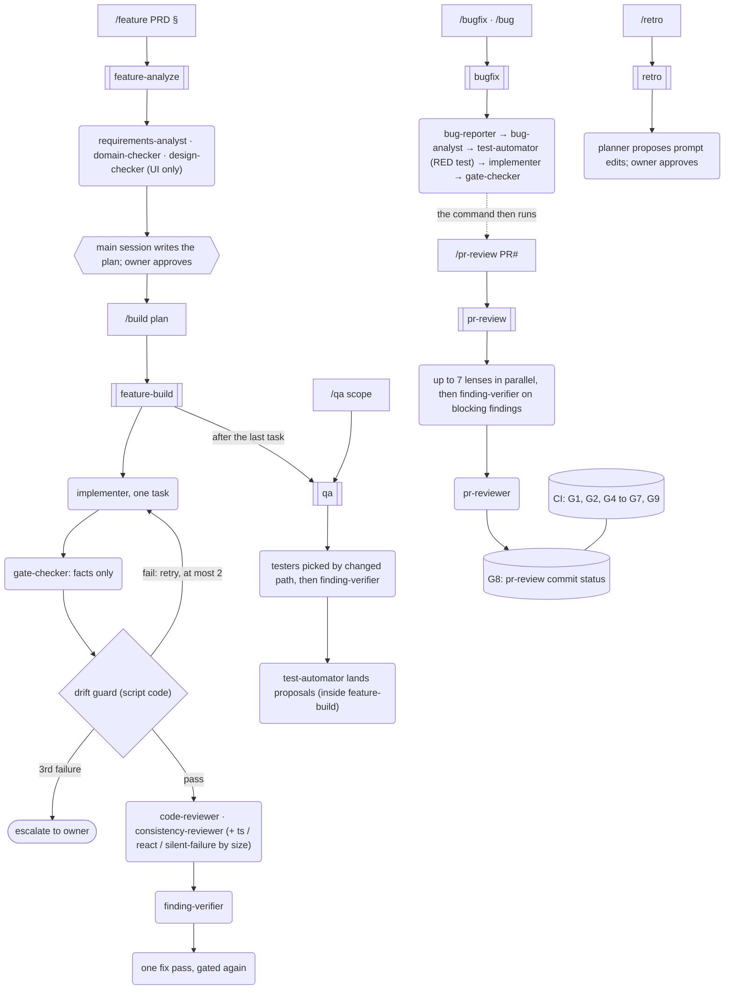

# How AI builds Credit Coach: the agentic delivery system

This page is for judges. It describes what is built in this repo on `main` today. Where something is
designed but not yet exercised, it says so.

**What exists:** 26 agents in `.claude/agents/`, 11 slash commands in `.claude/commands/`, 6 Workflow
scripts in `.claude/workflows/`, 12 project skills in `.claude/skills/`, and 5 hooks in
`.claude/hooks/`. The design is `docs/superpowers/specs/2026-10-21-agentic-dev-system-design.md`.
The build plan is `docs/superpowers/plans/2026-10-21-plan-1c-agentic-system.md`. The main decisions
are in [ADR 0002](adr/0002-curated-ai-dev-setup.md) and [ADR 0003](adr/0003-agentic-delivery-system.md).

## Commands → workflows → agents → gates

A Claude Code subagent can't start other subagents. So the coordinator is a **Workflow script**
that the main session runs, not an agent. The script decides what runs next. Agents never
coordinate each other, and every agent call has an output schema.

- `/tidy` and `/worktrees` are read-only Node scripts (`.claude/hooks/bin/`). `/verify` and
  `/journal` run in the main session with no workflow.
- `feature-build` calls `qa` inline. That is the only workflow-to-workflow call.
  `bugfix` hands its PR to `/pr-review` through the command text, not through a workflow call.

## Control policies

The shared rules live in `.claude/hooks/lib/contracts.mjs` and are unit-tested once. Workflow
scripts can't `import`, so each of the 6 workflows pastes the `// <contracts>` block byte for byte,
and `workflows-sync.test.mjs` fails `pnpm verify` on any difference. Rules that apply to only one
workflow, such as `pr-review`'s verifier rules below, live in that workflow's body.

- **Drift guard (spec §8.2).** After every `implementer` run, `gate-checker` reports git facts and
  `checkDrift` judges them. The agent's own `status` never counts. The attempt fails on:
  - a file outside the task's `Files:` list, or an uncommitted or missing file
  - a test command that differs from the plan's, or failing tests
  - `pnpm verify` not exiting 0
  - a commit that isn't a conventional commit, or that has an AI attribution line
  - missing facts (these fail closed, never read as "clean")
- **Retry and escalation (spec §8.3).** `nextStep` allows at most 2 retries. Each retry's brief
  carries the exact failure reasons. A null agent result counts as a failed attempt. After the third
  failure the task escalates, and the owner chooses: re-split the task, switch the agent or model, or
  decide. Testers and reviewers don't retry. In `qa` and `pr-review` a failed one is reported in
  `failedTesters` / `failedLenses`, and a failed lens forces `request-changes`. In `feature-build`
  a failed task-level reviewer is only logged and its findings are lost; this is open (see
  `docs/status.md`).
- **Verifier policy (spec §14.4).** `applyVerifierPolicy`: a `security` or `critical` finding stays
  confirmed unless `finding-verifier` refutes it with confidence ≥ 0.8. Any other finding is refuted
  unless it is confirmed with confidence ≥ 0.8. Only confirmed findings reach a fix pass. Two
  workflow-specific rules sit on top:
  - `pr-review` treats a missing or crashed verdict on a blocking finding as **confirmed** (fail
    closed). In `end-of-plan` mode a reviewer's critical/high finding means "not passed" whatever the
    verifier says.
  - `feature-build` and `qa` pass a missing verdict straight to the policy. So a crashed verifier
    drops a non-security `high` finding there. This asymmetry is open (see `docs/status.md`).
- **Untrusted input.** Diffs, findings and PR text reach prompts only inside `wrapUntrusted` fences.
  In `feature-build` and `qa`, the approved plan text is passed unfenced as the spec, and
  reviewers, testers and verifiers are told not to confirm a finding whose fix would change what
  the plan requires (`planConflictGuidance`). This is prompt guidance, not enforcement. It was
  added after the W2-2 dry run, where a fix pass rewrote a plan's own acceptance test.

## Token policy

The model tier is the cheapest one that is sufficient per job. This follows ECC's
`the-longform-guide.md` §Token Optimization and §Best Practices for Agents (affaan-m/ECC @
`90606c8`, MIT): "delegate the cheapest possible model that is sufficient", and each agent gets one
clear input and produces one clear output. Tiers come from each agent's `model:` frontmatter.

| Tier   | Agents                                                                                           | Why                                                             |
| ------ | ------------------------------------------------------------------------------------------------ | --------------------------------------------------------------- |
| Haiku  | `gate-checker`, `pm-sync`, `journal-writer`, `bug-reporter` (4)                                  | Runs commands or formats records; no judgement                  |
| Sonnet | the other 20: build, test, review, verify, analysis                                              | ECC's default for most coding and review work                   |
| Opus   | `planner`, `pr-reviewer` (2); plus a per-call `model: 'opus'` for `pr-review`'s end-of-plan pair | Plan second opinion, and the agent holding the merge-gate token |

Where this differs:

- **From ECC's table:** ECC puts PR review on Sonnet and security analysis on Opus. Here
  `pr-reviewer` is Opus because it posts G8, and `security-reviewer` runs on Sonnet.
- **From spec §8.4:** the spec says "Opus only for plan second opinions and the end-of-plan
  review". `pr-reviewer` on Opus follows the spec's own §5 and §8.9 roster rows instead.

Other levers: briefs instead of context dumps; schema output caps (summary ≤ 420 chars, finding
detail ≤ 560, evidence output ≤ 300); testers selected by changed path (at most 6 per run); and
verify-before-fix. **Not built yet:** per-run token accounting (`stats.tokens` is `null`). `/retro`
reads an `## Agent stats` ledger table that no ledger emits yet, so it has no data to work on.

## Session hygiene and cost

- Work one ticket per session. Run `/clear` between tickets, and `/compact` when the context gets
  long.
- For anything larger than a single task, plan first with `/feature` and get the owner's approval
  before building.
- Write the `docs/status.md` handoff at the end of the session. In a parallel wave, write it in the
  run ledger instead (see `CLAUDE.md`).
- Run `/cost` at the end of the session and record the total in that run's ledger under `Cost:`.
  No ledger in `docs/agent-runs/` has a `Cost:` line yet.
- Per-run token accounting inside the workflows is still not built (`stats.tokens` is `null`).
- **Telemetry:** `.claude/settings.json` turns on Claude Code's OpenTelemetry metrics
  (`CLAUDE_CODE_ENABLE_TELEMETRY=1`, OTLP to `localhost:4317`) and never sets
  `OTEL_LOG_USER_PROMPTS`, so no prompt text is exported. `scripts/otel/compose.yaml` runs a local
  collector that writes sessions, token counts, cost, lines changed, commits and PRs to
  `scripts/otel/data/` (gitignored). Read it when writing a run ledger or a `/retro`.
- **Budget and owner:** the owner (ShubhamU55) owns AI spend. The budget is the owner's
  fixed-price Claude subscription; there is no pay-per-token key for development, so spend cannot
  run past it. The alert is the plan's usage limits: the `token-meter` status line shows the
  5-hour and 7-day usage and turns to its warning band near a limit, and Claude Code warns before
  a limit is reached. Near a limit, the owner moves review lenses to cheaper models
  (see "Token policy") rather than stopping a gate.

## Where the evidence lives

- **Run ledgers:** `docs/agent-runs/`. There is one per wave of Plan 1c, with its review rounds,
  fix rounds and rulings (from Wave 2 on, each ruling states its cost if wrong). The W2-2 dry run of
  `/build` on a real task is `2026-10-26-dry-run-plan-4a-task-2.md`.
- **Journal:** `docs/journal/`, including where the AI was wrong. Examples: a reviewer and verifier
  silently overriding a plan (001), a remote-code-execution path in `pr-reviewer` caught in review
  (002), and fail-open gate logic caught in Wave 4 (003).
- **Tests:** `.claude/hooks/` (Vitest) holds the contracts, every workflow (run on a fake
  runtime), agent lint, config audit and hooks. They run in `pnpm verify` and CI.
- **Decisions:** `docs/adr/`. **Handoff:** `docs/status.md`.

## Honest limits (as of 30 Oct 2026)

- Two live workflow runs are on record, covering three workflows, and the ledgers show only these
  two runs. An earlier version of `feature-build` and `qa` ran once, in the W2-2 dry run, with
  injected faults. `pr-review` ran once, on a throwaway PR (#3) with one scratch file. That proves the plumbing, not review quality.
  Every later change to `feature-build` and `qa` is unit-tested only: `6316f15`, `ae9c8fc`,
  `3485e8c`, `d37f0a8` and `fd7f0a6`. `feature-analyze`, `bugfix` and `retro` have only run on the
  test harness's fake runtime. The first real `/feature` → `/build` → `/qa` → `/pr-review` run on a
  product task is their real test.
- The product tickets PD-1 to PD-4 and PD-7 were built test-first without `/build` or any
  Workflow script. PD-1 and PD-2 each ran as an implementer session dispatched by the
  parallel-streams coordinator (the PD-2 ledger header calls it an implementer subagent), and the
  coordinator ran the reviewer passes on all of them. Only the PD-3 and PD-7 ledgers call this the
  manual fallback. None of these tickets is evidence for the workflows.
- `main` is protected (ledger `2026-10-23-branch-protection.md`; ruleset 26139084 and the branch
  protection API re-read on 30 Oct 2026). A pull request is required, with 0 approvals. Branches
  must be up to date before merging. 12 checks are required: `verify`, `admin-e2e`, `secrets`,
  `deps`, `codeql`, `CodeQL`, `sonar`, `maestro-evidence`, `changes`, `hold-check`, `pr-body` and
  `pr-review`. Admins are included, force pushes are blocked and history must be linear.
- `pr-review` is a required check, but G8 is still self-attested. The PR author, the review author
  and the status creator are all the same GitHub account, so the status proves the review ran, not
  that an independent reviewer agreed. An independent G8 needs a separate identity for
  `pr-reviewer`. G3 (API tests) arrives with Plan 3.
- `build-error-resolver` exists, but no workflow dispatches it. Retries go back to `implementer`.
- The shell hooks (`block-no-verify`, `pre-bash-commit-quality`) match both `Bash` and `PowerShell`.
  A PowerShell here-string commit message is blocked as unreadable. `protect-env` and
  `config-protection` guard `Write`, `Edit` and `MultiEdit`, not an edit made through a shell tool.
